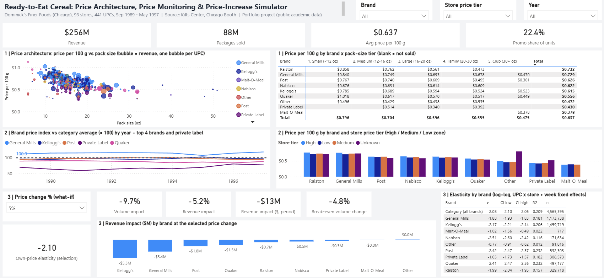

# Cereal Pricing & Revenue Management Dashboard (Power BI + Python)

A portfolio project rebuilt from university coursework (Decision Support Systems).
It reproduces three everyday tasks of an FMCG pricing / revenue-management analyst on real scanner data:

1. **Price architecture** - price per 100 g by brand x pack size (does the pack ladder make sense?).
2. **Price monitoring** - brand price index vs the category average, by store price tier and over time.
3. **Price-increase what-if** - a +X % slider that applies own-price elasticities estimated from the data to
   show volume and revenue impact per brand.

Everything is generated from code: `prep.py` builds the star schema and estimates elasticities,
`build_pbip.py` writes the Power BI Project (TMDL semantic model + PBIR report), `validate_pbip.py` checks
every JSON file against Microsoft's published schemas. No manual clicks were used to build the report.

Repository: <https://github.com/Talgat20056/cereal-pricing-dashboard>

> This is a learning project on public academic data, not work experience and not company data.
> Built with AI-assisted coding (Claude Code); analysis design, validation and conclusions reviewed by me.
> Not affiliated with or endorsed by Dominick's, the Kilts Center, or any manufacturer or brand named in the data;
> brand results describe 1989-1997 data from one retailer and say nothing about these companies today.



## Data source and licence

**Dominick's Finer Foods scanner data**, James M. Kilts Center for Marketing, University of Chicago Booth
School of Business - <https://www.chicagobooth.edu/research/kilts/datasets/dominicks>.
Store-level weekly scanner data for a 93-store Chicago chain, Sept 1989 - May 1997. Category used:
ready-to-eat cereal (`upccer.csv` + `wcer.csv`, 490 UPCs, 6.6 M store-UPC-week rows) plus the store
demographics file (`demo_stata.zip`) for price tiers.

Licence terms (from the data manual): *"This data is provided for academic research purposes only. All users of
this data should acknowledge the James M. Kilts Center, University of Chicago Booth School of Business."*
The raw files and the 185 MB row-level fact table are therefore **not** in the repository (`.gitignore`);
`prep.py` recreates them from the public download links. For the same reason the product, store and UPC-mapping
tables (`dim_product.csv`, `dim_store.csv`, `upc_mapping_audit.csv`) are generated locally by `prep.py` and not committed. Dunnhumby "The Complete Journey" was evaluated and
rejected because its brand field only says National/Private.

## How to open the dashboard

1. Power BI Desktop from **September 2026 or later** (tested on 2.159, Oct 2026). PBIP, TMDL and PBIR are GA,
   so **no Preview feature is required**. On an older build enable *Power BI Project (.pbip) save option*,
   *Store semantic model using TMDL format* and *Store reports using enhanced metadata format (PBIR)* under
   File > Options and settings > Options > Preview features, then restart.
2. Make sure `output/` contains the five CSVs (run `python prep.py` if not - see below).
3. Double-click **`pbip/Cereal Pricing.pbip`**. The page renders immediately with empty visuals and a banner
   *"Some of the tables have incomplete or no data"* - click **Refresh** once (about 40 s for 4.6 M rows).
   Save afterwards and Desktop keeps a local data cache, so the next open is instant.
4. **Set the data path** (required once): the committed model points at the placeholder `C:\path\to\output`.
   Either open Home > Transform data > **Manage parameters** and set `DataFolder` to the absolute path of your
   `output` folder (no trailing backslash), then Refresh - or regenerate the project with the path baked in:
   `python build_pbip.py --data-folder "C:\full\path\to\cereal-pricing-dashboard\output"`. It is the only path in the model
   (`pbip/Cereal Pricing.SemanticModel/definition/expressions.tmdl`).

## Reproduce the data

```bash
pip install -r requirements.txt
# download into data/raw/:  upccer.csv, wcer.zip (unzip to data/raw/wcer/wcer.csv), demo_stata.zip (unzip to data/raw/demo/demo.dta)
#   https://www.chicagobooth.edu/-/media/enterprise/centers/kilts/datasets/dominicks-dataset/upc_csv-files/upccer.csv
#   https://www.chicagobooth.edu/-/media/enterprise/centers/kilts/datasets/dominicks-dataset/movement_csv-files/wcer.zip
#   https://www.chicagobooth.edu/boothsitecore/docs/dff/store-demos-customer-count/demo_stata.zip
python prep.py                 # ~70 s: cleans, validates, estimates elasticities, writes output/*.csv + metrics.json
python build_pbip.py --data-folder "<abs path>\output"   # regenerates pbip/ (omit the flag for the placeholder path)
python validate_pbip.py        # schema-validates the PBIP (downloads microsoft/json-schemas on first run)
```

## Method

**Cleaning** (`prep.py`, full counts in `output/data_quality_report.md`): keep rows Kilts flags as valid
(`OK = 1`), drop weeks with zero units or price, drop non-cereal / variety / trial-size UPCs and 3 UPCs whose
size cannot be parsed (never guessed), drop 531 price outliers (> 2.5x or < 0.35x the UPC's median price).
Result: 4,575,924 rows, 441 UPCs, 93 stores, 366 weeks, $256.1 M revenue, 88.0 M packages.

**Unit price**: revenue / grams sold x 100, i.e. volume-weighted price per 100 g. **Brand price index** = brand
price per 100 g / category price per 100 g in the same stores and weeks x 100.

**Elasticity**: per brand, `ln(units) = e ln(price) + b promo + UPC x store FE + week FE`, OLS after two-way
demeaning, standard errors clustered by UPC x store. Identification comes from within-item weekly price
changes (temporary price cuts and Dominick's zone-pricing experiments), so `e` is a short-run elasticity.

| Brand | e | 95 % CI | within R2 | n (store-UPC-weeks) | UPCs |
|---|---:|---|---:|---:|---:|
| Kellogg's | -2.17 | [-2.21, -2.14] | 0.21 | 1,459,719 | 114 |
| General Mills | -1.88 | [-1.93, -1.83] | 0.18 | 1,173,738 | 94 |
| Post | -2.42 | [-2.47, -2.37] | 0.23 | 532,303 | 43 |
| Quaker | -2.41 | [-2.47, -2.36] | 0.23 | 497,177 | 44 |
| Ralston | -1.99 | [-2.04, -1.95] | 0.16 | 329,718 | 51 |
| Private Label | -1.65 | [-1.73, -1.57] | 0.18 | 308,573 | 22 |
| Nabisco | -2.51 | [-2.60, -2.42] | 0.12 | 171,634 | 23 |
| Category (all) | -2.08 | [-2.10, -2.06] | 0.21 | 4,565,395 | 408 |

("Other" -0.77 and Malt-O-Meal -1.02 are statistically weak and labelled as such in the model.)
All estimates fall inside the -0.3 to -5 plausibility window; dropping the promo control makes the top five brands
0.5-0.75 more elastic, which is reported as a robustness column.

**What-if**: constant-elasticity demand per brand, `Units' = Units (1+p)^e`, `Revenue' = Revenue (1+p)^(1+e)`,
driven by a what-if parameter table (-20 % to +20 %, 1 % steps).

## Data model (star schema, `output/`)

| Table | Grain / keys | Rows |
|---|---|---:|
| `fact_sales.csv` -> **Sales** | store_id x upc x week_id: units, revenue, volume_oz, pack_price, promo | 4,575,924 |
| `dim_product.csv` -> **Product** *(generated, not committed)* | upc: product, brand, product line, pack size oz/g, pack tier, private-label flag | 441 |
| `dim_store.csv` -> **Store** *(generated, not committed)* | store_id: city, zone, price tier (High/Medium/Low), cluster, income | 93 |
| `dim_week.csv` -> **Calendar** | week_id: week start/end, year, quarter, month | 366 |
| `dim_brand_elasticity.csv` -> **Brand** | brand: elasticity, SE, CI, R2, n, flag (+ category row) | 10 |
| *(calculated)* **Price Change %** | what-if parameter, GENERATESERIES(-20, 20, 1) percent points | 41 |
| *(calculated)* **Pricing Measures** | 24 DAX measures with descriptions, 4 display folders | - |

Relationships: Sales -> Product (UPC), Sales -> Store (Store ID), Sales -> Calendar (Week ID),
Product -> Brand (Brand). One Power Query parameter `DataFolder` feeds every table.

## The three insights (details and "so what" in `INSIGHTS.md`)

1. **Pack architecture is the price ladder.** Price per 100 g falls from $0.80 (packs < 12 oz) to $0.48 (30 oz+),
   a 40 % quantity discount. General Mills holds its family-pack price 29 % above Kellogg's ($0.68 vs $0.52 per 100 g).
2. **Private label's discount is not constant.** Its price index vs the category moved from 59 (1991) to 80 (1996)
   as branded players cut list prices; Kellogg's index went from 102.5 (1995) to 97.6 (1996).
3. **At a promo-driven elasticity of about -2, the outcome of a price increase depends on how it is executed.**
   With e = -2.17, +5 % on Kellogg's simulates -10.1 % volume and -5.6 % revenue (-$5.3 M over the period) against
   a -4.8 % break-even; because the elasticity comes from temporary price cuts it overstates the reaction to a
   permanent increase, so the real outcome lies in between and the levers are pack architecture, cost
   pass-through and the promo calendar.

## Limitations

- 1989-1997 data from one Chicago chain; results illustrate method, not today's market.
- Elasticities are short-run and promotion-driven; they likely overstate the response to a permanent list-price
  change and ignore cross-brand switching. Treat simulator output as an upper bound on volume loss.
- Dominick's promo flag is under-recorded; the promo control is imperfect.
- 32 chain-wide gap weeks exist in the source (weeks 262-265, 284-309, 370-371).
- The matrix / index treat "brand" as manufacturer brand; sub-brand analysis is available via `Product Line`.
- No cost or margin layer (retailer margin in the raw data is not manufacturer margin).

## Repository layout

```
cereal-pricing-dashboard/
+-- prep.py                 data prep, validation, elasticity, CSV export, metrics.json
+-- build_pbip.py           generates pbip/ (TMDL model + PBIR report) from code
+-- validate_pbip.py        JSON-schema validation + TMDL lint
+-- requirements.txt
+-- data/raw/               (git-ignored) Kilts downloads
+-- output/                 metrics.json, data_quality_report.md, aggregate CSVs (row-level and master tables are generated by prep.py)
+-- pbip/
|   +-- Cereal Pricing.pbip
|   +-- Cereal Pricing.SemanticModel/definition/*.tmdl, tables/*.tmdl
|   +-- Cereal Pricing.Report/definition/report.json, pages/PricingDashboard/visuals/*/visual.json
+-- assets/                 base theme, dashboard screenshot
+-- README.md  INSIGHTS.md  BUILD_GUIDE.md  DECISIONS.md
```

Acknowledgement: data provided by the James M. Kilts Center for Marketing, University of Chicago Booth School of Business.
